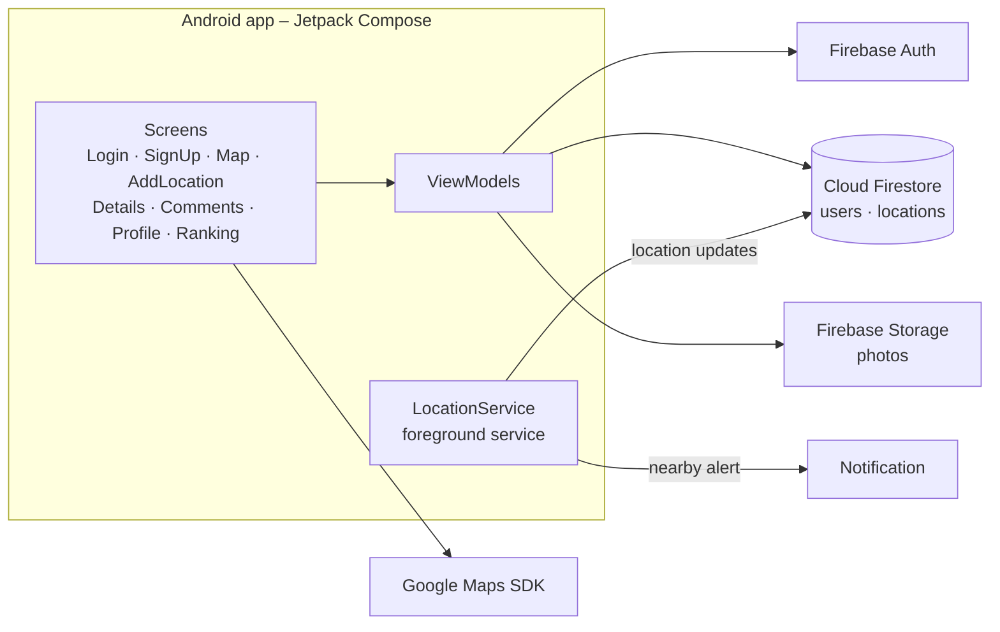

# BizTravel

An Android app for business travelers. Users **map useful business locations** such as coworking spaces, hotels, meeting spots and restaurants, **comment on them**, and **earn points** for contributing. A background location service **notifies users when they are near a saved location**.

Built with **Kotlin** and **Jetpack Compose** on **Firebase** (Auth, Firestore, Storage) and **Google Maps**.

## Features

### 🗺️ Interactive map
- Google Map centered on the user's current location
- **Tap anywhere on the map to add a new business location** at that point
- Tap a marker to preview a location and open its details

### 🔍 Search and filters
- Search locations by **name**
- Filter by **type** and by **author** (the user who added the location)
- **Distance filter:** a slider (in km) shows only locations within the chosen range of your current position

### 📍 Adding locations
- Name, type, description and a photo, either **taken with the camera** or **picked from the gallery**
- The photo is uploaded to **Firebase Storage** and the location is saved to **Firestore** with its coordinates, author and creation time

### 💬 Location details and comments
- Details page with photo, type, description and author
- Comment thread for every location

### 🏆 Gamification
| Action             | Points |
|--------------------|:------:|
| Add a location     | **+3** |
| Post a comment     | **+1** |

- A **leaderboard** ranks all users by points. Points are updated in a **Firestore transaction** so concurrent updates are safe.

### 🔔 Background location service
- An Android **foreground service** that the user starts or stops from their profile
- Uses the **Fused Location Provider** for location updates every 5–10 seconds and syncs the user's position to Firestore
- Sends a **push notification** when the user comes within **1 km** of a saved business location

### 👤 Accounts
- Sign up and log in with **Firebase Authentication** (email and password)
- Profile with name, phone number and a profile photo taken with the camera
- The user stays logged in between app launches

## Architecture



- **UI:** Jetpack Compose screens with **Navigation Compose**. Coordinates are passed as route arguments.
- **State:** a `ViewModel` per screen, using coroutines with Firebase `await()`
- **Data:** Firestore collections `users` (profile, points, last location, service status) and `locations` (location data, author, embedded comments)

## Tech stack

| Area          | Technologies                                                                 |
|---------------|------------------------------------------------------------------------------|
| Language / UI | Kotlin, Jetpack Compose, Material, Navigation Compose                        |
| Backend       | Firebase Authentication, Cloud Firestore, Firebase Storage                  |
| Maps          | Google Maps SDK (Maps Compose), Fused Location Provider                      |
| Media         | Activity Result API (camera and gallery), Coil for image loading             |
| Android       | Foreground Service, Notifications, runtime location permissions; min SDK 24, target SDK 34 |

## Project structure

```
app/src/main/java/com/example/biztravel2/
├── MainActivity.kt
├── AppNavigation.kt              # NavHost and routes
├── components/                   # Compose screens
│   ├── LoginScreen.kt, SignUpScreen.kt
│   ├── MapScreen.kt              # map, search, filters, distance slider
│   ├── AddLocationScreen.kt      # form + camera/gallery
│   ├── LocationDetailsScreen.kt, LocationCommentsScreen.kt
│   ├── ProfilePageScreen.kt      # profile + start/stop location service
│   └── UserRankingScreen.kt      # leaderboard
└── server/                       # ViewModels, Firebase logic, LocationService
```

## Running

1. Open the project in **Android Studio**.
2. Create a Firebase project with **Authentication** (Email/Password), **Firestore** and **Storage** enabled, and put its `google-services.json` in `app/`.
3. Add a **Google Maps API key** to `AndroidManifest.xml` (`com.google.android.geo.API_KEY`).
4. Run on a device or emulator (API 24+) and grant the location, camera and notification permissions.
